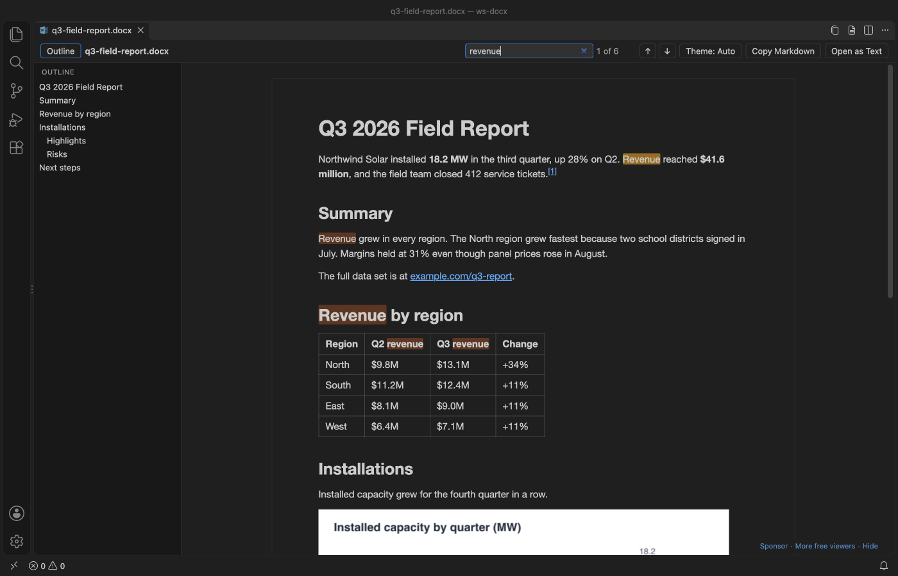
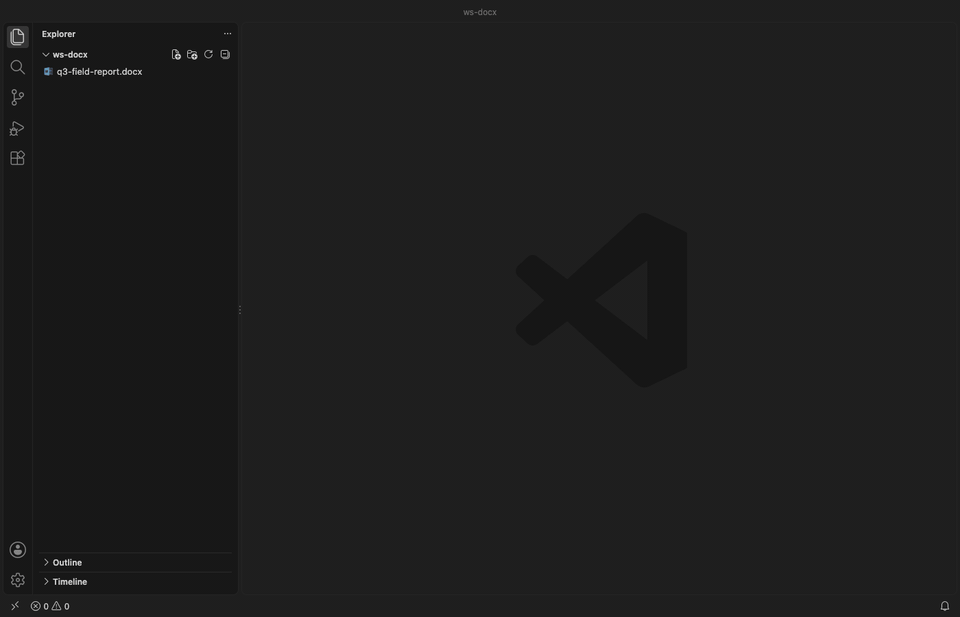
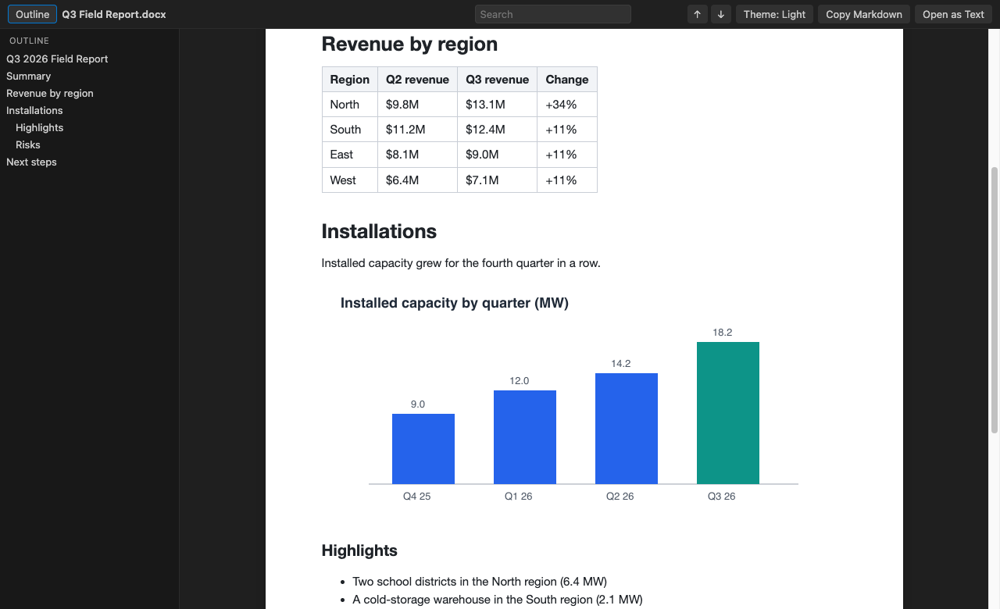
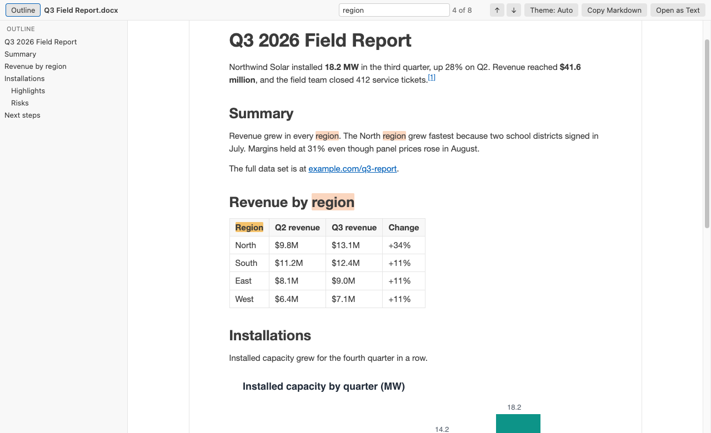
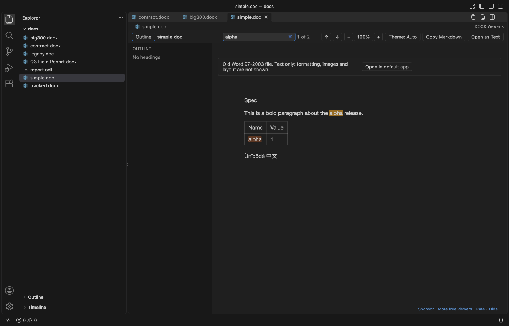
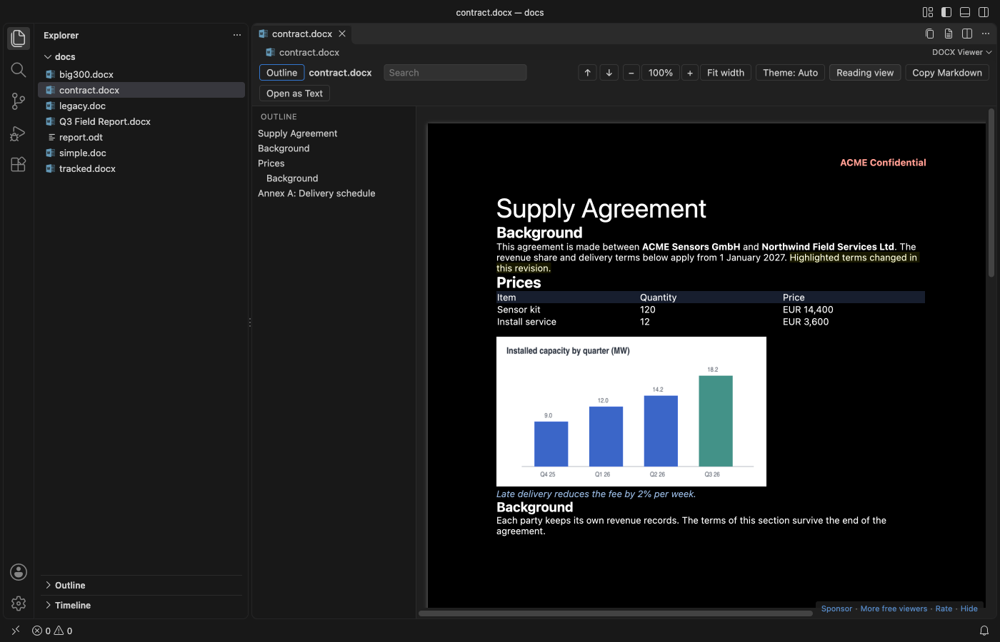
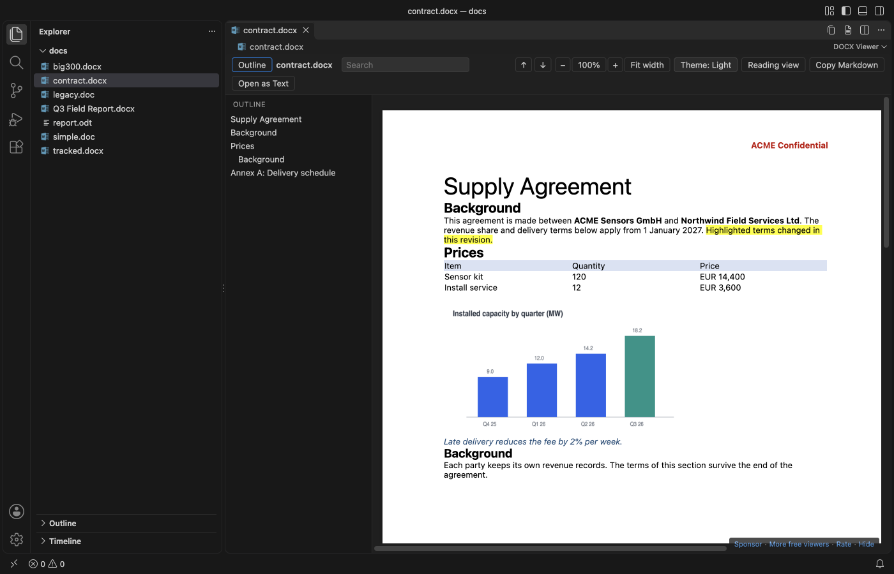
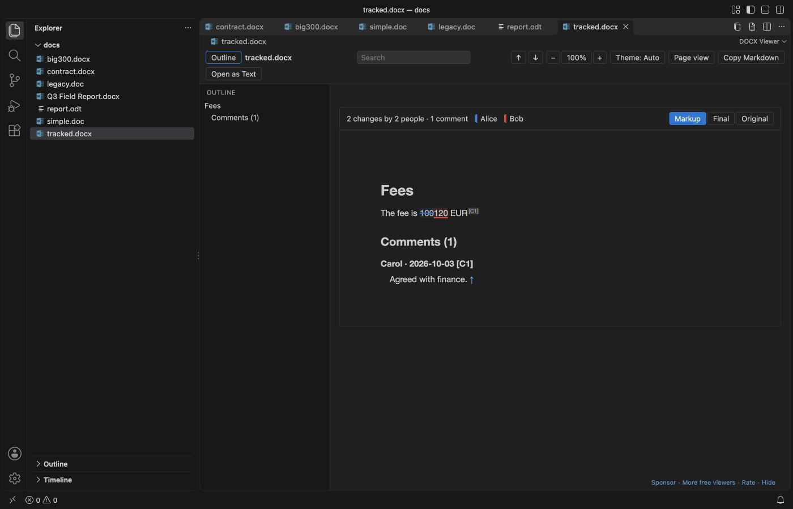

# DOCX Viewer, Word Viewer & DOCX Preview (Dark Mode)

For developers who get specs and contracts as Word files, DOCX Viewer opens .docx files in VS Code as a dark-mode preview with an outline, search and tables.

*A real VS Code 1.142 window running this extension on [`test/fixtures/sample.docx`](test/fixtures/sample.docx), a generated 2 page field report with a table and a chart.*

- Read Word and OpenDocument (.odt) specs, contracts and reports next to your code. The page follows your VS Code theme, or switch to white paper with one click.
- Find things fast. Search shows a match count, and the outline jumps to any heading.
- See what changed. Compare a document with its last Git commit, or with another version, in the VS Code diff view. Or copy the whole document as Markdown with tables and footnotes.

## Quick start

1. Install DOCX Viewer.
2. Click any `.docx` or `.dotx` file in the Explorer. It opens as a read-only preview. Press `Ctrl+F` (`Cmd+F` on macOS) to search.

*Recorded in the same window. The white arrow is drawn in to show where each click lands.*

No .docx at hand? Run "DOCX Viewer: Open Sample Document" from the Command Palette.

## What it shows

Headings, paragraphs, bold, italic, underline and strikethrough. Bulleted and numbered lists, including nested ones. Tables with merged cells. Images inline (PNG, JPEG, GIF, BMP and WebP). Footnotes and endnotes, with links between the reference and the note. Hyperlinks, which open in your browser.

It reads `.docx`, `.dotx` (templates) and `.docm` files, and OpenDocument text files (`.odt` and `.ott` templates) from LibreOffice, Google Docs downloads and pandoc. Macros in `.docm` files never run. The viewer only reads the text and images.

Old Word 97-2003 `.doc` and `.dot` files open as text. You get the paragraphs, simple tables, and the headers, footers, footnotes, comments and text boxes in their own sections. A grey bar says that formatting, images and layout are not shown, with a button to open the file in your default app. Search, Copy as Markdown, Open as Text and both compare commands work on them. A password-protected file gets a short message instead, and so does an RTF or HTML file saved with a `.doc` name. A password-protected `.docx` gets a similar message, since Word stores those in an encrypted container.

## Page view

Click "Page view" in the toolbar to see the document the way Word lays it out. You get the page size and margins, portrait and landscape pages, headers and footers, fonts, colors, highlights, table borders and shading, and footnotes. "Reading view" switches back. VS Code keeps your choice for the workspace, and `docxViewer.defaultView` sets it for new ones.

- Zoom goes from 50% to 300% with the minus and plus buttons, or `Ctrl+=` and `Ctrl+-` (`Cmd` on macOS). `Ctrl+0` goes back to 100%, and "Fit width" fits the widest page to the window. Reading view zooms the same way.
- In a dark theme the pages turn dark too, and photos and charts keep their colors. The theme button switches to white paper.
- The outline and search work on the pages, and search also finds text in headers and footers.
- Page view opens `.docx`, `.dotx` and `.docm` files. Files over 20 MB (`docxViewer.pageViewMaxMB`) open in Reading view, with a button to try Page view anyway. If a file can't be laid out, it opens in Reading view with a one-line note.

## Tracked changes and comments

When a `.docx` has tracked changes or comments, a bar at the top of Reading view counts them, for example "12 changes by 2 people · 4 comments". Markup underlines insertions and strikes through deletions in one color per author, and when you hover a change you see who made it and when. Comments get small numbered markers and a Comments section at the end with the author and date.

"Final" shows the document as if every change were accepted, and "Original" as if every change were rejected. Copy as Markdown, Open as Text and the compare commands always use Final. The viewer only reads the file, so nothing gets accepted or rejected in it.

## Compare versions

Word files are binary, so `git diff` shows nothing useful for them. Right-click a `.docx` or `.odt` file in the Explorer or in Source Control and pick "Compare with Git HEAD". Both versions are turned into Markdown and open in the VS Code diff view, with changed words, table rows and headings marked. It's also in the `...` menu of the viewer.

To compare two files, select both in the Explorer and pick "Compare with Another Document...", or run it on one file and pick the second. A `.docx` can be compared with an `.odt`.

Git runs on your machine with hooks and fsmonitor turned off, and only in a trusted workspace. The compare shows text and structure. Changes to fonts, colors or images alone don't show.

## Commands

| Command | What it does |
| --- | --- |
| "DOCX Viewer: Find in Document" | Puts the cursor in the search box (`Ctrl+F` / `Cmd+F`) |
| "DOCX Viewer: Copy as Markdown" | Copies the whole document as Markdown |
| "DOCX Viewer: Open as Text" | Opens the plain text in a new untitled editor |
| "DOCX Viewer: Open as Markdown" | Opens the Markdown in a new untitled editor |
| "DOCX Viewer: Open in Default App" | Opens the file in Word, Pages or LibreOffice |
| "DOCX Viewer: Compare with Git HEAD" | Shows what changed since the last commit, as a Markdown diff |
| "DOCX Viewer: Compare with Another Document..." | Shows the differences between two documents, as a Markdown diff |
| "DOCX Viewer: Open Sample Document" | Opens a short sample report |
| "DOCX Viewer: Support the developer" | Opens the GitHub Sponsors page |
| "DOCX Viewer: More free viewers" | Lists the other Zovo extensions and installs the one you pick |

"Copy as Markdown", "Open as Text" and the two compare commands are also in the Explorer right-click menu for `.docx`, `.odt` and `.doc` files, so you can grab the text without opening the preview.

In the search box, `Enter` goes to the next match and `Shift+Enter` to the previous one. `Esc` clears it.

## Settings

| Setting | Default | Meaning |
| --- | --- | --- |
| `docxViewer.theme` | `auto` | `auto` follows VS Code, `light` shows white paper, `dark` a dark page |
| `docxViewer.defaultView` | `reading` | `page` opens Word files in Page view in new workspaces. The toolbar switch is kept per workspace. |
| `docxViewer.zoom` | `1` | Zoom for both views, from `0.5` to `3` |
| `docxViewer.pageViewMaxMB` | `20` | Bigger files open in Reading view, with a button to try Page view anyway |
| `docxViewer.maxFileSizeMB` | `50` | Bigger files ask before they open |
| `docxViewer.maxImageSizeMB` | `5` | Bigger images show a placeholder instead |
| `docxViewer.maxTotalImagesMB` | `40` | After this many MB of images, the rest show placeholders |
| `docxViewer.askForRating` | `true` | Ask one time for a Marketplace rating, after 5 files and 2 days. Turn it off with `false`. |
| `docxViewer.showSupportLinks` | `true` | Show the small Sponsor and More free viewers line at the bottom right of the viewer. Turn it off with `false`. |

## Big files

The converter runs in a worker thread with a memory cap and a 60 second limit, so a huge or broken file can't freeze VS Code. The page fills in from the top in chunks of about 200 KB of HTML, and you can read the first screen while the rest arrives. A test document of about 300 pages (97,000 words and 500 copies of one image) converted in about 1 second on an Apple M3 Pro. In Page view, a similar 300 page test file showed its first page in under a second in a real VS Code window.

## Privacy

DOCX Viewer works offline. It makes no network calls and sends no telemetry. The webview runs under a strict Content Security Policy with no remote scripts and no network access, and the document HTML is rebuilt from an allowlist with all text escaped before it reaches the page. Remote images, scripts and `javascript:` links in a document are dropped. Page view allows inline styles, which the page layout needs, and blocks the rest the same way.

## Limits

- It's a viewer. It can't edit or save a document.
- Reading view simplifies the layout. It leaves out page size, margins, headers, footers, columns, text boxes, fonts and colors, so the text reads like a clean web page. Page view shows them.
- Page view doesn't show tracked changes or comments. It says so and offers Reading view.
- Charts, SmartArt and equations don't show. EMF, WMF and TIFF images show a placeholder. Tracked changes to paragraph marks, formatting and table rows show as in Final.
- `.doc` files show text only. Some `.doc` files that macOS TextEdit or `textutil` saved at more than about 2.4 MB can't be read and get the could-not-read message.
- Search finds text inside one formatting run. A word whose letters have mixed formatting may not match.
- In Markdown, images become placeholder links such as `` to keep the text small.
- In `.odt` files, styles set by name in the document (Title, Quotations, Preformatted Text) and direct bold, italic, underline, strikethrough and superscript show. Other paragraph styles, frames and drawings are simplified. SVG and linked images show a placeholder. OpenDocument spreadsheets and presentations don't open. Tracked changes and comments in `.odt` files are not shown.

## Credits

The .docx conversion uses [mammoth](https://github.com/mwilliamson/mammoth.js) (BSD-2-Clause). Page view uses [docx-preview](https://github.com/VolodymyrBaydalka/docxjs) (Apache-2.0), and `.doc` files are read with [word-extractor](https://github.com/morungos/node-word-extractor) (MIT). The .odt reader is part of this extension and uses JSZip (MIT) and @xmldom/xmldom (MIT), which mammoth already bundles. See [THIRD-PARTY-NOTICES.md](THIRD-PARTY-NOTICES.md) for every bundled package and its license.

## License

MIT

## Support Zovo

Zovo extensions are free, with no ads and no tracking. They are made by [theluckystrike](https://github.com/theluckystrike) on GitHub. If this one saves you time, you can support the work:

- [Sponsor on GitHub](https://github.com/sponsors/theluckystrike)
- [Follow theluckystrike on GitHub](https://github.com/theluckystrike)

## More tools by Zovo

- [PPTX Viewer & PowerPoint Viewer](https://marketplace.visualstudio.com/items?itemName=zovo.pptx-slide-viewer) shows PowerPoint slides, thumbnails and speaker notes.
- [PDF Viewer & PDF Reader with Dark Mode](https://marketplace.visualstudio.com/items?itemName=zovo.pdf-viewer-dark) reads PDFs with a real dark mode, search, an outline and thumbnails.
- [CSV Viewer, Excel Viewer (XLSX) & Parquet Viewer](https://marketplace.visualstudio.com/items?itemName=zovo.table-viewer-vscode) opens CSV, TSV, Excel and Parquet files as a sortable, filterable table.
- [Graphviz Preview & DOT Viewer](https://marketplace.visualstudio.com/items?itemName=zovo.zovo-graphviz-preview) shows a live preview of DOT files and exports SVG or PNG.
- [Large JSON Viewer & JSON Tree](https://marketplace.visualstudio.com/items?itemName=zovo.zovo-json-tree-viewer) shows large JSON files as a searchable tree, copies JSONPath and turns arrays of objects into a table.

See [all Zovo extensions on the Marketplace](https://marketplace.visualstudio.com/publishers/zovo).
