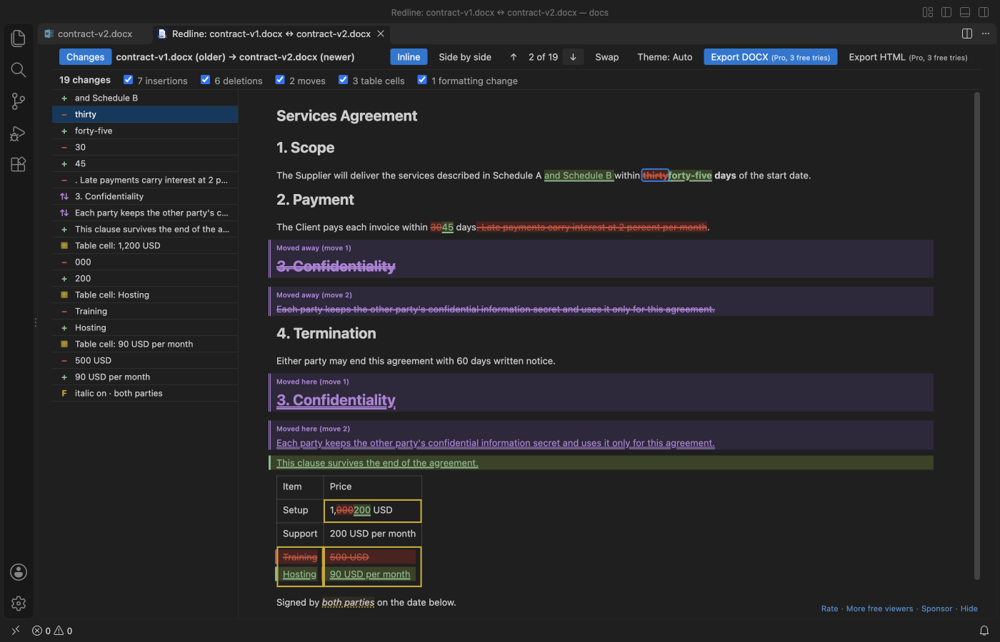
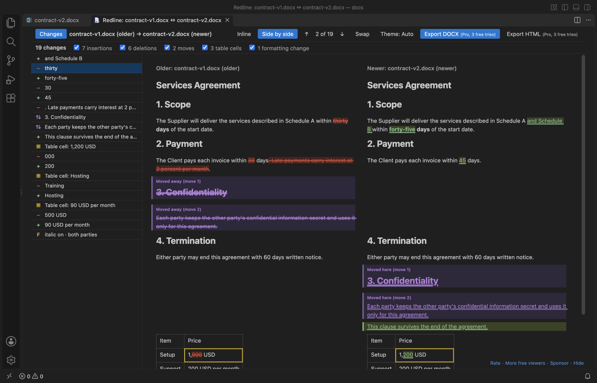
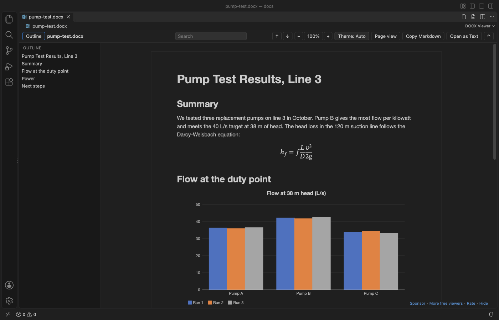
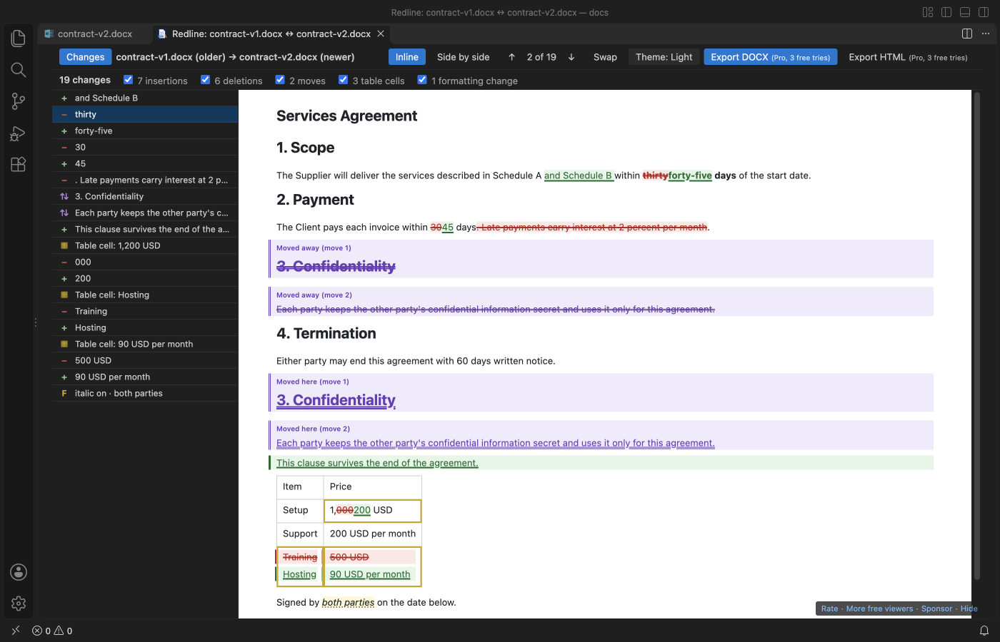

# DOCX Viewer & ODT Viewer, Word Document Preview (Dark Mode)

For developers who get specs, contracts and reports as Word files, DOCX Viewer opens .docx, .odt and old .doc files in VS Code as a dark-mode preview with an outline, search, tables, charts and equations. New in 0.4: compare Word documents as a redline, with tracked changes you can export to Word.

Free, offline, no sign-in. Optional Zovo Pro (USD 15 once, all Zovo viewers) exports a redline as a Word file with tracked changes and compares two folders of documents. Everything that is free today stays free. The only network call is the optional "Unlock with GitHub Sponsors" button for Zovo Pro, and only when you click it.

*A real VS Code 1.142 window running this extension on [`test/fixtures/sample.docx`](test/fixtures/sample.docx), a generated 2 page field report with a table and a chart.*

- Read Word and OpenDocument (.odt) specs, contracts and reports next to your code. The page follows your VS Code theme, or switch to white paper with one click.
- Find things fast. Search shows a match count, and the outline jumps to any heading.
- See what changed. Compare two versions of a Word document, or a document with its last Git commit, as a redline: insertions underlined, deletions struck through, moved paragraphs, changed table cells and formatting changes marked, with a change list. Or copy the whole document as Markdown with tables and footnotes.
- Open big real-world files. A 47 MB government report with 41 photos opens in about 1.5 seconds, and Page view lays it out in under half a second. The preview reloads when the file changes on disk. The whole extension is a 0.8 MB download and needs no Office or LibreOffice.
- Works in the browser too. In vscode.dev and github.dev, click a .docx in a GitHub repository and read it without cloning.

## New in 0.4.0, compare Word documents as a redline

*A real VS Code window running this extension on two versions of a contract from the test suite ([`test/helpers/redline-fixtures.js`](test/helpers/redline-fixtures.js)).*

- Right-click a Word file and pick "Compare Documents (Redline)...", or run "Compare with Git HEAD" and choose Redline. You get one document with word-level insertions (underlined) and deletions (struck through).
- Moved paragraphs show as moves, not as a deletion plus an insertion. Changed table cells are outlined one by one. Bold, italic, underline, size and paragraph style changes are marked when "Formatting" is on.
- A change list with a count ("7 insertions, 6 deletions, 2 moves, 3 table cells, 1 formatting change"), filters by type, and next/previous with `F7` and `Shift+F7`, as in the VS Code diff editor.
- Side by side: older on the left, newer on the right, scrolling together.
- Export the redline as a new `.docx` with real tracked changes (author "Compare") that Word and LibreOffice can accept or reject one by one, or as one HTML file that prints to PDF. Your two documents are never changed. (Zovo Pro, with 3 free tries.)
- Fast on big files: two 500-page documents with 200 tables compare in about half a second in a background worker, with progress and Cancel.

## Quick start

1. Install DOCX Viewer.
2. Click any `.docx` or `.dotx` file in the Explorer. It opens as a read-only preview. Press `Ctrl+F` (`Cmd+F` on macOS) to search.

*Recorded in the same window. The white arrow is drawn in to show where each click lands.*

No .docx at hand? Run "DOCX Viewer: Open Sample Document" from the Command Palette.

## What it shows

Headings, paragraphs, bold, italic, underline and strikethrough. Bulleted and numbered lists, including nested ones. Tables with merged cells. Images inline: PNG, JPEG, GIF, BMP and WebP, plus EMF, WMF and TIFF, which the viewer draws itself (see Limits). Equations and charts (see below). Figure and table numbers. Footnotes and endnotes, with links between the reference and the note. Hyperlinks, which open in your browser.

It reads `.docx`, `.dotx` (templates) and `.docm` files, and OpenDocument text files (`.odt` and `.ott` templates) from LibreOffice, Google Docs downloads and pandoc. Macros in `.docm` files never run. The viewer only reads the text and images.

Old Word 97-2003 `.doc` and `.dot` files open as text. You get the paragraphs, simple tables, and the headers, footers, footnotes, comments and text boxes in their own sections. A grey bar says that formatting, images and layout are not shown, with a button to open the file in your default app. Search, Copy as Markdown, Open as Text and both compare commands work on them. An old `.doc` file renamed to `.docx` or `.docm` opens the same way. Many websites publish RTF files with a `.doc` name; those open as text too, with their tables. A password-protected file gets a short message that says so, and so does an HTML file saved with a `.doc` name.

## Equations and charts

Word equations show as real math in Reading view: fractions, roots, sub- and superscripts, sums and integrals with limits, brackets, matrices and equation arrays. Copy as Markdown and Open as Text write them as one line of text, such as `x=(-b±√(b^2-4ac))/(2a)`.

Charts are drawn again from the numbers Word saves inside the file, so you see them without Excel: column, bar, line, area, pie, doughnut and scatter charts, with the title, the legend and a value on hover. "Chart data" under each chart opens its table, and Copy as Markdown copies that table.

## Page view

Click "Page view" in the toolbar to see the document the way Word lays it out. You get the page size and margins, portrait and landscape pages, headers and footers, fonts, colors, highlights, table borders and shading, and footnotes. "Reading view" switches back. VS Code keeps your choice for the workspace, and `docxViewer.defaultView` sets it for new ones.

- Zoom goes from 50% to 300% with the minus and plus buttons, or `Ctrl+=` and `Ctrl+-` (`Cmd` on macOS). `Ctrl+0` goes back to 100%, and "Fit width" fits the widest page to the window. Reading view zooms the same way.
- In a dark theme the pages turn dark too, and photos and charts keep their colors. The theme button switches to white paper.
- The outline and search work on the pages, and search also finds text in headers and footers.
- Page view opens `.docx`, `.dotx` and `.docm` files. Files over 100 MB (`docxViewer.pageViewMaxMB`) open in Reading view, with a button to try Page view anyway. If a file can't be laid out, it opens in Reading view with a one-line note.

## Tracked changes and comments

When a `.docx` has tracked changes or comments, a bar at the top of Reading view counts them, for example "12 changes by 2 people · 4 comments". Markup underlines insertions and strikes through deletions in one color per author, and when you hover a change you see who made it and when. Comments get small numbered markers and a Comments section at the end with the author and date.

"Final" shows the document as if every change were accepted, and "Original" as if every change were rejected. Copy as Markdown, Open as Text and the compare commands always use Final. The viewer only reads the file, so nothing gets accepted or rejected in it.

## Compare versions

Word files are binary, so `git diff` shows nothing useful for them. DOCX Viewer has two compare views, and asks which one you want (setting `docxViewer.compareView`):

- Redline shows the formatted document with insertions, deletions, moves, table cells and formatting changes marked, a change list, filters, `F7` navigation and a side-by-side mode. Desktop VS Code.
- Markdown diff shows both versions as Markdown in the VS Code diff editor, with changed words, table rows and headings marked.

How to start one:

- Two files: select both in the Explorer and pick "Compare Documents (Redline)..." or "Compare with Another Document...", or run it on one file and pick the second. The file changed longest ago goes on the left as the older version; "Swap" in the redline changes that.
- Git: right-click a `.docx` or `.odt` file in the Explorer or in Source Control and pick "Compare with Git HEAD", or run "Redline against Git HEAD".
- Any mix works: `.docx`, `.docm`, `.dotx`, `.odt` and old `.doc` files (as text).

Tracked changes that are already in a file are accepted first, so the redline compares the final text of both versions. The redline follows your VS Code theme, and the Theme button switches to white paper.

### Export the redline (Zovo Pro)

"Export DOCX" writes a new Word document built on the newer version: its styles, numbering, headers, footers, pictures and comments stay, and every difference becomes a tracked change by "Compare" with today's date. Inserted and deleted words are `w:ins` and `w:del`, moved paragraphs `w:moveFrom` and `w:moveTo`, added and removed table rows are row revisions, and formatting changes are formatting revisions. After writing it, DOCX Viewer accepts and rejects every change in a copy and checks that the result is the newer and the older text; the message after saving tells you the result.

"Export HTML" writes one self-contained HTML file with the change list and the marked text, for people without Word. Open it in a browser and print it to PDF.

### Compare two folders (Zovo Pro)

"Compare Two Folders of Documents..." pairs every Word and OpenDocument file in an older folder with the file of the same name in a newer folder, saves one HTML redline per changed pair and an `index.html` with the counts, and opens any pair in the redline view.

Git runs on your machine with hooks and fsmonitor turned off, and only in a trusted workspace.

## Why this one

Other DOCX extensions for VS Code are viewers. Their users have asked for exactly this kind of compare:

- "Show the differences of a Word file in a Git commit": [vscode-office issue 392](https://github.com/cweijan/vscode-office/issues/392) (12 comments) and the follow-up [#493](https://github.com/cweijan/vscode-office/pull/493). DOCX Viewer marks every changed word, moved paragraph and table cell against Git HEAD, and exports the result as tracked changes.
- "Render plus compare differences within different checkouts" and "Synchronous scrolling for compared documents": [Docx-Viewer issue 11](https://github.com/skfrost19/Docx-Viewer/issues/11) and [#9](https://github.com/skfrost19/Docx-Viewer/issues/9). The redline's side-by-side mode puts both versions in one scrolling view, so they always stay in step, and the changes are marked on both sides.
- Speed on large Word files comes up in [Office Viewer's reviews](https://marketplace.visualstudio.com/items?itemName=cweijan.vscode-office&ssr=false#review-details) ("a bit slow(ish) when handling larger Word documents", October 2026). Here, a 500-page pair compares in about half a second in a worker thread, under 5 seconds from the command to the finished redline on screen with the file dialog included, and VS Code stays responsive (see Big files).

## Commands

| Command | What it does |
| --- | --- |
| "DOCX Viewer: Find in Document" | Puts the cursor in the search box (`Ctrl+F` / `Cmd+F`) |
| "DOCX Viewer: Copy as Markdown" | Copies the whole document as Markdown |
| "DOCX Viewer: Open as Text" | Opens the plain text in a new untitled editor |
| "DOCX Viewer: Open as Markdown" | Opens the Markdown in a new untitled editor |
| "DOCX Viewer: Open in Default App" | Opens the file in Word, Pages or LibreOffice |
| "DOCX Viewer: Compare with Git HEAD" | Shows what changed since the last commit, as a redline or a Markdown diff |
| "DOCX Viewer: Compare with Another Document..." | Shows the differences between two documents, as a redline or a Markdown diff |
| "DOCX Viewer: Compare Documents (Redline)..." | Opens the redline of two documents directly |
| "DOCX Viewer: Redline against Git HEAD" | Opens the redline against the last commit directly |
| "DOCX Viewer: Export Redline as DOCX with Tracked Changes (Pro)" | Saves the open redline as a Word file with tracked changes |
| "DOCX Viewer: Export Redline as HTML (Pro)" | Saves the open redline as one HTML file |
| "DOCX Viewer: Compare Two Folders of Documents (Pro)..." | Redlines every pair of same-named documents in two folders |
| "DOCX Viewer: Zovo: Unlock Pro with GitHub Sponsors" | Unlocks Zovo Pro if you sponsor theluckystrike on GitHub |
| "DOCX Viewer: Zovo: Get Pro (USD 15 once, all Zovo viewers)" | Opens the GitHub Sponsors page |
| "DOCX Viewer: Zovo: Enter License Key" | Adds a Zovo Pro license key (checked on your computer) |
| "DOCX Viewer: Show or Hide the Toolbar" | Hides the toolbar for more reading room, and shows it again (`Ctrl+Shift+H` / `Cmd+Shift+H` in the viewer). The small button at the top right also brings it back. |
| "DOCX Viewer: Open Sample Document" | Opens a short sample report |
| "DOCX Viewer: Support the developer" | Opens the GitHub Sponsors page |
| "DOCX Viewer: More free viewers" | Lists the other Zovo extensions and installs the one you pick |

"Copy as Markdown", "Open as Text" and the two compare commands are also in the Explorer right-click menu for `.docx`, `.odt` and `.doc` files, so you can grab the text without opening the preview.

In the search box, `Enter` goes to the next match and `Shift+Enter` to the previous one. `Esc` clears it.

## Settings

| Setting | Default | Meaning |
| --- | --- | --- |
| `docxViewer.theme` | `auto` | `auto` follows VS Code, `light` shows white paper, `dark` a dark page |
| `docxViewer.defaultView` | `reading` | `page` opens Word files in Page view in new workspaces. The toolbar switch is kept per workspace. |
| `docxViewer.zoom` | `1` | Zoom for both views, from `0.5` to `3` |
| `docxViewer.fontFamily` | empty | Font for Reading view. Empty keeps the Word-like default, `editor` uses your editor font, or give a font list such as `Georgia, serif` |
| `docxViewer.pageViewMaxMB` | `100` | Bigger files open in Reading view, with a button to try Page view anyway |
| `docxViewer.maxFileSizeMB` | `100` | Bigger files ask before they open |
| `docxViewer.maxImageSizeMB` | `20` | Bigger images show a placeholder instead |
| `docxViewer.maxTotalImagesMB` | `300` | After this many MB of images, the rest show placeholders |
| `docxViewer.compareView` | `ask` | What the two compare commands open: `ask`, `redline` or `markdown` |
| `docxViewer.redlineFormatting` | `true` | Mark formatting-only changes in the redline and write them as formatting revisions in the DOCX export |
| `docxViewer.showProFeatures` | `true` | Show the Zovo Pro buttons and commands (redline export, folder compare). `false` hides them |
| `docxViewer.askForRating` | `true` | Ask for a Marketplace rating after 3 files opened without an error on 2 different days. "Later" asks one more time after 7 days, "No thanks" never again. It never asks after an error. Turn it off with `false`. |
| `docxViewer.showSupportLinks` | `true` | Show the small Sponsor and More free viewers line at the bottom right of the viewer. Turn it off with `false`. |

## Big files

The converter runs in a worker thread with a memory cap and a 60 second limit, so a huge or broken file can't freeze VS Code. Pictures go to the viewer as raw bytes instead of text, which keeps big reports fast. The page fills in from the top in chunks of about 200 KB of HTML, and you can read the first screen while the rest arrives.

Measured in a real VS Code 1.142 window on an Apple M3 Pro, from the click in the Explorer to the finished page:

| File | 0.2.5 | 0.3.0 |
| --- | --- | --- |
| 47 MB government report, 41 photos, 31 headings | 4.1 s, 6 photos left out | 1.4 to 1.6 s, all 41 photos |
| Same report in Page view | Reading view only (over 20 MB) | 0.4 s, 41 photos |
| 475 KB report with 39,000 words | 1.9 s | 1.8 to 1.9 s |

Redline compare, measured on the same Mac (two 500-page documents, 4,200 paragraphs and 200 tables each, with 280 scattered changes):

| Step | Time |
| --- | --- |
| Compare in the worker thread | 0.44 s |
| Export as DOCX with tracked changes, including the accept/reject check | 0.64 s |
| From the command in a real VS Code window to the finished redline on screen, file dialog included | 4.3 to 4.8 s; the editor answered within 0.1 s during the compare |
| Two unrelated documents (500 pages against a licence text) | 0.86 s |

A file whose Word part unpacks to more than 200 MB (a zip bomb) is refused before it is unpacked, and a password-protected file gets a message.

We test each release on 17 real-world files from public sources (Apache POI bug reports, a JNCC survey report, a gov.uk statistics file), including broken, password-protected and renamed files.

## Privacy

DOCX Viewer works offline. It makes no network calls and sends no telemetry. The one exception is "Unlock with GitHub Sponsors" for Zovo Pro: after you click it, VS Code signs you in to GitHub and the extension asks GitHub one question (do you sponsor theluckystrike); monthly sponsors get one silent recheck every 30 days. A license key is checked on your computer. Nothing about your documents is sent anywhere. The webview runs under a strict Content Security Policy with no remote scripts and no network access, and the document HTML is rebuilt from an allowlist with all text escaped before it reaches the page. Remote images, scripts and `javascript:` links in a document are dropped. Page view allows inline styles, which the page layout needs, and blocks the rest the same way.

## Limits

- It's a viewer. It can't edit or save a document.
- Reading view simplifies the layout. It leaves out page size, margins, headers, footers, columns, text boxes, fonts and colors, so the text reads like a clean web page. Page view shows them.
- Page view doesn't show tracked changes or comments. It says so and offers Reading view.
- SmartArt doesn't show. Excel 2016 chart types (waterfall, treemap and others) show the picture Word saved with them, if there is one. Page view draws equations its own way and shows charts only as their saved picture. Tracked changes to paragraph marks, formatting and table rows show as in Final.
- EMF and WMF pictures are drawn from their plain records. An EMF that has only EMF+ records (rare, some newer Office add-ins write them) shows a note instead. TIFF pictures show their first page; JPEG 2000 TIFFs show a note. A picture over `docxViewer.maxImageSizeMB`, an EMF or WMF with more than 200,000 records and a TIFF page over 40 megapixels show a note too.
- `.doc` files show text only. Some `.doc` files that macOS TextEdit or `textutil` saved at more than about 2.4 MB can't be read and get the could-not-read message.
- Search finds text inside one formatting run. A word whose letters have mixed formatting may not match.
- In VS Code for the Web (vscode.dev, github.dev), "Compare with Git HEAD" and "Open in Default App" are not available. To use them, open the folder in desktop VS Code.
- The redline compares the main text and tables. Changes in headers, footers, footnote text, text boxes and comments are not marked; the DOCX export keeps those parts of the newer document. Pictures, charts and equations count as one object each, so a changed picture shows only when one is added or removed.
- A paragraph counts as moved when it is unchanged. A paragraph that was moved and edited shows as a deletion and an insertion. A table whose rows changed their number of cells shows those rows as deleted and inserted.
- The DOCX export needs a Word file (`.docx`, `.docm`, `.dotx`) as the newer version. Deleted text is written with its bold, italic, underline, strikethrough and size; other formatting of deleted text and deleted pictures are not restored when you reject. Exports pass the ISO/IEC 29500 schema check and a reject-all test against the older file. They were not opened in Microsoft Word or LibreOffice for this release.
- The redline and the folder compare need desktop VS Code. In VS Code for the Web, the compare commands open the Markdown diff.
- In Markdown, images become placeholder links such as `` to keep the text small.
- In `.odt` files, styles set by name in the document (Title, Quotations, Preformatted Text) and direct bold, italic, underline, strikethrough and superscript show. Other paragraph styles, frames and drawings are simplified. SVG and linked images show a placeholder. OpenDocument spreadsheets and presentations don't open. Tracked changes and comments in `.odt` files are not shown.

## Free and Pro

Everything you could do before stays free: Reading and Page view, search, the outline, tracked changes and comments, Copy as Markdown, the Markdown compare, and the on-screen redline with its change list, filters and side-by-side mode.

Zovo Pro adds the redline exports (DOCX with tracked changes, HTML) and the folder compare. Each one works 3 times on your computer before it asks. Zovo Pro is USD 15 once on [GitHub Sponsors](https://github.com/sponsors/theluckystrike?frequency=one-time) and unlocks the Pro features in every Zovo VS Code viewer. If you have already sponsored USD 10 or more, run "Zovo: Unlock Pro with GitHub Sponsors". No popups on open, no ads, no countdown. Set `docxViewer.showProFeatures` to `false` to hide the Pro buttons and commands.

## Credits

The .docx conversion uses [mammoth](https://github.com/mwilliamson/mammoth.js) (BSD-2-Clause). Page view uses [docx-preview](https://github.com/VolodymyrBaydalka/docxjs) (Apache-2.0), and `.doc` files are read with [word-extractor](https://github.com/morungos/node-word-extractor) (MIT). WMF pictures are drawn with WMFJS from [rtf.js](https://github.com/tbluemel/rtf.js) (MIT) and TIFF pictures are read with [UTIF.js](https://github.com/photopea/UTIF.js) (MIT). The EMF drawing code is part of this extension. The .odt reader is part of this extension and uses JSZip (MIT) and @xmldom/xmldom (MIT), which mammoth already bundles. See [THIRD-PARTY-NOTICES.md](THIRD-PARTY-NOTICES.md) for every bundled package and its license.

## License

MIT

## Support Zovo

Zovo extensions are free, with no ads and no tracking. They are made by [theluckystrike](https://github.com/theluckystrike) on GitHub. If this one saves you time, you can support the work:

- [Sponsor on GitHub](https://github.com/sponsors/theluckystrike)
- [PayPal](https://www.paypal.com/paypalme/najzzz)
- [Follow theluckystrike on GitHub](https://github.com/theluckystrike)

## More tools by Zovo

- [Office Viewer Pack](https://marketplace.visualstudio.com/items?itemName=zovo.zovo-file-viewers): adds the other three Office viewers in one install.
- [PPTX Viewer & PowerPoint Preview, PPT Presentation Slideshow](https://marketplace.visualstudio.com/items?itemName=zovo.pptx-slide-viewer) shows PowerPoint slides, thumbnails and speaker notes.
- [PDF Viewer & Reader to Read and View PDF in Dark Mode](https://marketplace.visualstudio.com/items?itemName=zovo.pdf-viewer-dark) reads PDFs with a real dark mode, search, an outline and thumbnails.
- [XLSX Viewer & CSV Preview for Excel, XLS & Parquet](https://marketplace.visualstudio.com/items?itemName=zovo.table-viewer-vscode) opens CSV, TSV, Excel and Parquet files as a sortable, filterable table.
- [EML Viewer, Email Headers & MBOX Viewer](https://marketplace.visualstudio.com/items?itemName=zovo.eml-viewer) reads EML, EMLX and MBOX email files with remote images blocked.

See [all Zovo extensions on the Marketplace](https://marketplace.visualstudio.com/publishers/zovo).
