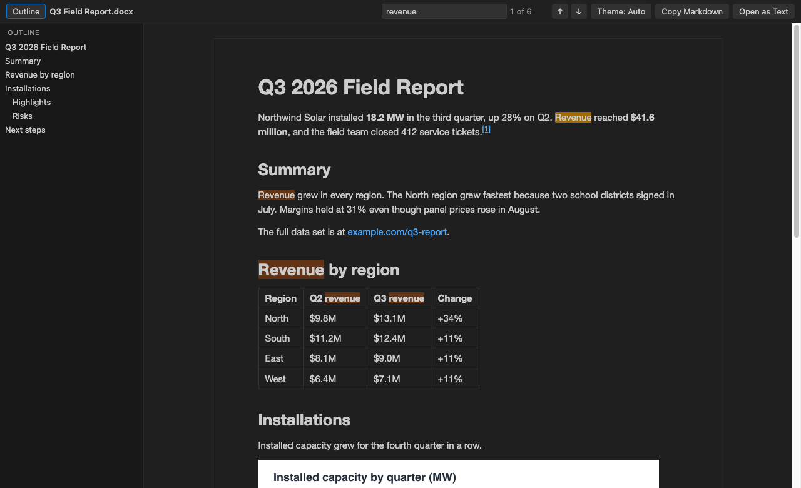
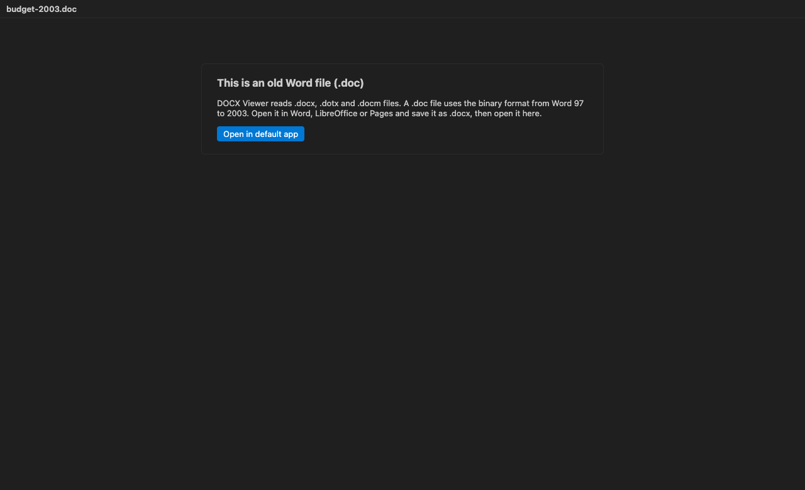

# DOCX Viewer & Word Viewer with Dark Mode

Open Word .docx files right in VS Code and read them in dark mode, with an outline, search and tables, without leaving the editor.

*Real output. The webview HTML and `media/` files from this extension rendered the sample document [`test/fixtures/sample.docx`](test/fixtures/sample.docx) in headless Chrome, with VS Code's Dark Modern colors passed in as `--vscode-*` variables. `npm run screenshot` makes it again.*

- Read specs, contracts and reports next to your code. The page follows your VS Code theme, or switch to white paper with one click.
- Find things fast. Search shows a match count, and the outline jumps to any heading.
- Get the text out. Copy the whole document as Markdown with tables and footnotes, or open its plain text in a new editor.

## Quick start

1. Install DOCX Viewer.
2. Click any `.docx` or `.dotx` file in the Explorer. It opens as a read-only preview. Press `Ctrl+F` (`Cmd+F` on macOS) to search.

No .docx at hand? Run "DOCX Viewer: Open Sample Document" from the Command Palette.

## What it shows

Headings, paragraphs, bold, italic, underline and strikethrough. Bulleted and numbered lists, including nested ones. Tables with merged cells. Images inline (PNG, JPEG, GIF, BMP and WebP). Footnotes and endnotes, with links between the reference and the note. Hyperlinks, which open in your browser.

It reads `.docx`, `.dotx` (templates) and `.docm` files. Macros in `.docm` files never run. The viewer only reads the text and images.

An old binary `.doc` file opens to a short message that explains the format and offers to open it in your default app. A password-protected `.docx` gets a similar message, since Word stores those in an encrypted container.

## Commands

| Command | What it does |
| --- | --- |
| DOCX Viewer: Find in Document | Puts the cursor in the search box (`Ctrl+F` / `Cmd+F`) |
| DOCX Viewer: Copy as Markdown | Copies the whole document as Markdown |
| DOCX Viewer: Open as Text | Opens the plain text in a new untitled editor |
| DOCX Viewer: Open as Markdown | Opens the Markdown in a new untitled editor |
| DOCX Viewer: Open in Default App | Opens the file in Word, Pages or LibreOffice |
| DOCX Viewer: Open Sample Document | Opens a short sample report |

"Copy as Markdown" and "Open as Text" are also in the Explorer right-click menu for `.docx` files, so you can grab the text without opening the preview.

In the search box, `Enter` goes to the next match and `Shift+Enter` to the previous one. `Esc` clears it.

## Settings

| Setting | Default | Meaning |
| --- | --- | --- |
| `docxViewer.theme` | `auto` | `auto` follows VS Code, `light` shows white paper, `dark` a dark page |
| `docxViewer.maxFileSizeMB` | `50` | Bigger files ask before they open |
| `docxViewer.maxImageSizeMB` | `5` | Bigger images show a placeholder instead |
| `docxViewer.maxTotalImagesMB` | `40` | After this many MB of images, the rest show placeholders |
| `docxViewer.askForRating` | `true` | Ask one time for a Marketplace rating, after 5 files and 2 days. Turn it off with `false` |

## Big files

The converter runs in a worker thread with a memory cap and a 60 second limit, so a huge or broken file can't freeze VS Code. The page fills in from the top in chunks of about 200 KB of HTML, and you can read the first screen while the rest arrives. A test document of about 300 pages (97,000 words and 500 copies of one image) converted in about 1 second on an Apple M3 Pro.

## Privacy

DOCX Viewer works offline. It makes no network calls and sends no telemetry. The webview runs under a strict Content Security Policy with no remote scripts, and the document HTML is rebuilt from an allowlist with all text escaped before it reaches the page. Remote images, scripts and `javascript:` links in a document are dropped.

## Limits

- It's a viewer. It can't edit or save a document.
- Layout is simplified. Page size, margins, headers, footers, columns, text boxes, fonts and colors from Word are not shown. The text reads like a clean web page, not like a printed page.
- Charts, SmartArt and equations don't show. EMF, WMF and TIFF images show a placeholder. Tracked changes show the current text, and comments are left out.
- Search finds text inside one formatting run. A word whose letters have mixed formatting may not match.
- In Markdown, images become placeholder links such as `` to keep the text small.

## Credits

The .docx conversion uses [mammoth](https://github.com/mwilliamson/mammoth.js) (BSD-2-Clause). See [THIRD-PARTY-NOTICES.md](THIRD-PARTY-NOTICES.md) for every bundled package and its license.

## License

MIT

## More viewers by Zovo

- [Context Drift](https://marketplace.visualstudio.com/items?itemName=zovo.context-drift) finds stale facts in AGENTS.md, CLAUDE.md and other agent rule files.
- [PDF Viewer & Reader with Dark Mode](https://marketplace.visualstudio.com/items?itemName=zovo.pdf-viewer-dark) reads PDFs with a dark mode, search, an outline and thumbnails.
- [CSV, Excel & Parquet Viewer](https://marketplace.visualstudio.com/items?itemName=zovo.table-viewer-vscode) opens Parquet, Excel and CSV files as a sortable, filterable table.
- [HDF5 & NetCDF Explorer](https://marketplace.visualstudio.com/items?itemName=zovo.hdf5-netcdf-explorer) browses groups, variables and attributes in scientific data files.
- [PPTX Viewer for PowerPoint](https://marketplace.visualstudio.com/items?itemName=zovo.pptx-slide-viewer) shows PowerPoint slides, thumbnails and speaker notes.
- [Skill Shelf](https://marketplace.visualstudio.com/items?itemName=zovo.skill-shelf) lists, checks and toggles the Agent Skills that Claude Code, Codex and Cursor load.
- [Tensor Viewer](https://marketplace.visualstudio.com/items?itemName=zovo.tensor-viewer) shows NPY, NPZ, Safetensors and GGUF tensors with stats and heatmaps.
